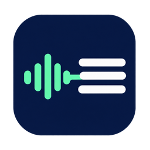

# MP3reading



Applicazione desktop per trascrivere file audio e salvare il risultato in un file TXT. L’interfaccia è in italiano. La trascrizione supporta italiano, inglese e rilevamento automatico della lingua.

## Versione web

[Apri MP3reading nel browser](https://gabriholler98.github.io/MP3reading/). La pagina scarica Whisper tramite [Transformers.js](https://huggingface.co/docs/transformers.js/) e trascrive l’audio nel browser. I formati leggibili dipendono dal browser. Per iniziare, scegli un file MP3 o WAV.

## Installazione su Windows

Installa [Python 3.12 a 64 bit](https://www.python.org/downloads/) con Tkinter e seleziona **Add Python to PATH** durante l’installazione. Apri PowerShell nella cartella di MP3reading ed esegui questi comandi.

```powershell
python -m venv .venv
.\.venv\Scripts\python.exe -m pip install -r requirements.txt
.\.venv\Scripts\python.exe app.py
```

Per avviare l’app le volte successive basta l’ultimo comando.

## Uso

1. Premi **Scegli audio** e seleziona una registrazione MP3, WAV, M4A, OGG, FLAC, Opus o AAC.
2. Scegli la lingua e il modello. Inizia con **Base · rapido**. Prova **Small · più accurato** se la trascrizione richiede troppe correzioni.
3. Premi **Trascrivi**. Puoi modificare il testo nell’app, copiarlo o salvarlo con **Salva TXT**.

Il primo utilizzo di ciascun modello richiede Internet per scaricarlo. La trascrizione avviene in locale sulla CPU e, una volta scaricato il modello, funziona anche offline. Per usare l’app bastano Python e le dipendenze elencate in `requirements.txt`.

Motore di trascrizione [Faster Whisper](https://github.com/SYSTRAN/faster-whisper).
